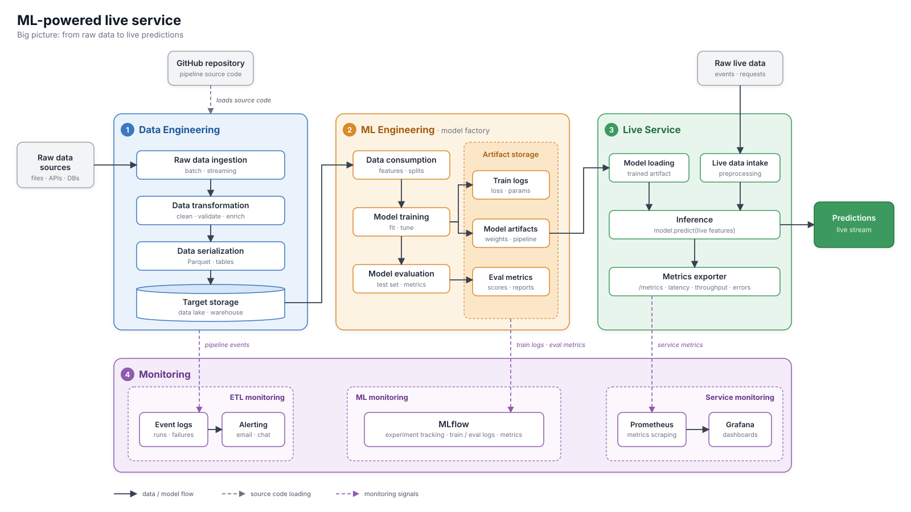

# Product

Big picture of a live service operated by a Machine Learning model.

1. **Data Engineering** — ingests raw data, transforms it, and serializes it into a target
   storage. Its code is loaded from a version controlled repository (GitHub, Gitlab, BitBucket), and emits events that feed
   monitoring and alerting.
2. **ML Engineering** — a model factory pipeline that consumes the prepared data, trains and
   evaluates a model, and stores the outputs: train logs, model artifacts and eval metrics.
3. **Live Service** — loads the trained model, reads raw live data, and outputs predictions as
   a live stream.
4. **Monitoring** — split into three areas:
   - *ETL monitoring*: pipeline events and alerting.
   - *ML monitoring*: MLflow for train / eval logs and metrics.
   - *Service monitoring*: Prometheus collects service metrics, Grafana shows them in dashboards.

