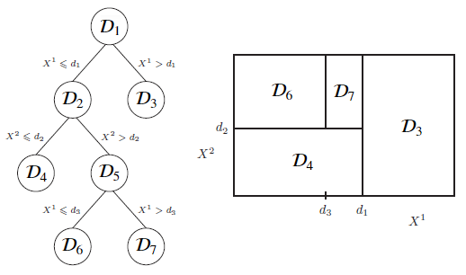

# Tree-based-classifiers

- [Decision Tree Classifier](#decision-tree-classifier)
  - [Splitting process](#splitting-process)
  - [Splitting strategy](#splitting-strategy)
  - [Reccurence process](#recurrence-process)
- [Random Forest Classifier](#random-forest-classifier)
- [Boosted Tree Classifier](#boosted-tree-classifier)

## Decision Tree Classifier

Implementing a Decision Tree Classifier is similar to implementing a Decision Tree Regressor, except on:

- The Hererogeneity criterion, specified with the `criterion` option
- The possible imbalance of importance of each category, specified with the `class_weight` option

Suppose we are given a dataset $\mathcal{D}_1$ described by two explanatory variables $X_1$ and $X_2$ and an output variable $Y$ taking values in a finite set of categories $\mathcal{C}$:

| $X^1$ | $X^2$ | $Y$ |
| ----- | ----- | ----- |
| $x^1_1$ | $x^2_1$ | $y_1$ |
| $x^1_2$ | $x^2_2$ | $y_2$ |
| $x^1_3$ | $x^2_3$ | $y_3$ |

### Splitting process

The decision tree will first split the dataset $\mathcal{D}_1$ into two sub-datasets $\mathcal{D}_2$ and $\mathcal{D}_3$, by choosing a variable among the explanatory variables (let's say $X^1$) and a separation threshold $d_1$ for this variable. The way of selecting a variable and a threshold is detailed in the *Splitting Strategy* paragraph below.
Such choice divides the dataset $\mathcal{D}_1$ into

$$\mathcal{D}_2 = \displaystyle \lbrace  (x^1, x^2, y) \in \mathcal{D}_1 \, | \, x^1 \leqslant d_1 \rbrace \qquad \qquad \mathcal{D}_3 = \{ (x^1, x^2, y) \in \mathcal{D}_1 \, | \, x^1 > d_1 \}$$

If the tree construction would stop here, the resulting decision tree $\mathcal{T}$ is a prediction model that associates, to any new data point $(o^1, o^2)$, the *probability distribution* over $\mathcal{C}$ according to the following two cases : if $o^1 \leqslant d_1$, then the probability $\mathcal{T}(o^1, o^2)(c)$ that $(o^1, o^2)$ has output class $c$ is given by the ratio of data points of $\mathcal{D}_2$ with $c$ as output class, whereas if $o^1 > d_1$, then the probability $\mathcal{T}(o^1, o^2)(c)$ that $(o^1, o^2)$ has output class $c$ is given by the ratio of data points of $\mathcal{D}_3$ with $c$ as output class.

This is more formally written, for each class $c \in \mathcal{C}$, as :

$$ \mathcal{T}(o^1, o^2)(c) = 
\begin{cases}
\displaystyle \frac{\vert \{(x^1, x^2, c) \, \in \, \mathcal{D}_2 \} \vert}{\vert \mathcal{D}_2 \vert } & \text{if } o^1 \leqslant d_1 \\
\displaystyle \frac{\vert \{(x^1, x^2, c) \, \in \, \mathcal{D}_3 \} \vert}{\vert \mathcal{D}_3 \vert } & \text{if } o^1 > d_1\\
\end{cases}
$$

As a byproduct, the subsequent classification of the point $(o^1, o^2)$ provided by the model is the most represented class in $\mathcal{D}_2$ if $o^1 \leqslant d_1$, and the most represented class in $\mathcal{D}_3$ else.

The tree construction does not stop here in general, but implement subsequent splittings as detained in the *Recurrence process* paragraph below.

### Splitting Strategy

The splitting strategy depends on the choice of a measure of *Heterogeneity* of a set of output values. For regression the heterogeneity was taken as the *variance* of a set of real values. For classification there are two measures of heterogeneity that are typically used, given a set $Y = \{ y_1, y_2, ...\}$ with each value $y_i$ belonging to a finite set $\mathcal{C}$, namely the *Gini impurity* and the *Entropy*.

Precisely, consider for each class $c\in \mathcal{C}$ the ratio of values in $Y$ equal to $c$:

$$\widehat{p}_c = \frac{\vert \{y_i \, \in \, Y \, | \, y_i = c \} \vert}{\vert Y \vert } $$

Then Gini impurity and Entropy are respectively defined by:

$$Gini(Y) = \sum _{c \, \in \, \mathcal{C}} \widehat{p}_c (1 - \widehat{p}_c) \qquad \qquad Ent(Y) = - \sum _{c \, \in \, \mathcal{C}} \widehat{p}_c \log _2(\widehat{p}_c) $$

Both quantities are positive, and cancel out (e.g. the impurity is null) if and only if $Y$ consists of multiple copies of a single class. The worse results are obtained when the probability $\widehat{p}$ is equidistributed, e.g. when $Y$ consists of the same number of copies of each class.

Now that the homogeneity of a set has been defined, the splitting strategy consists in chosing, given a set of data $\mathcal{D}$, a variable $X^*$ among $X^1$ and $X^2$ as well as a threshold $d^*$ that minimizes, among the possible variables and thresholds, the summed heterogeneity (we formulate it with Gini but Entropy works the same)

$$ \mathcal{D}_{left} = \lbrace (x^1, x^2, y) \in \mathcal{D}, \;  x^i \leqslant d \rbrace $$
$$ \mathcal{D}_{right} = \lbrace (x^1, x^2, y) \in \mathcal{D}, \;  x^i > d \rbrace $$

$$
H(\mathcal{D}, X^i, d) =  \vert \mathcal{D}_{left} \vert \times Gini(\lbrace y \, | \, (x^1, x^2, y) \in \mathcal{D}_{left} \rbrace) \quad +  \quad \vert \mathcal{D}_{right} \vert \times Gini(\lbrace y \, | \, (x^1, x^2, y) \in \mathcal{D}_{right} \rbrace)
$$

This quantity is the impurity obtained by splitting the dataset along the $X^*$ variable about the threshold $d^*$, and the resulting best choice is the one that minimizes this impurity.

### Recurrence process

The full decision tree is built by _iterating_ the splitting process : If the splitting strategy yields a first decision along a variable $X^1$ with threshold $d_1$, yielding two sub-datasets $\mathcal{D}_2$ and $\mathcal{D}_3$, then the same splitting strategy is performed on $\mathcal{D}_2$ and $\mathcal{D}_3$ independently. The process stops when the splitting strategy does not find any candidate variable and threshold over any of the sub-datasets obtained so far.

As an illustration, let us suppose that, after the first splitting step descrived earlier, that the splitting strategy finds no splitting on $\mathcal{D}_3$ and a splitting of $\mathcal{D}_2$ according to the variable $X^2$ and threshold $d_2$, yielding

$$\mathcal{D}_4 = \displaystyle \lbrace  (x^1, x^2, y) \in \mathcal{D}_2 \, | \, x^2 \leqslant d_2 \rbrace \qquad \qquad \mathcal{D}_5 = \{ (x^1, x^2, y) \in \mathcal{D}_2 \, | \, x^2 > d_2 \}$$

Suppose moreover that a third step yields a splitting of $\mathcal{D}_5$ according to the variable $X^1$ and threshold $d_3$, yielding

$$\mathcal{D}_6 = \displaystyle \lbrace  (x^1, x^2, y) \in \mathcal{D}_5 \, | \, x^1 \leqslant d_3 \rbrace \qquad \qquad \mathcal{D}_7 = \{ (x^1, x^2, y) \in \mathcal{D}_5 \, | \, x^1 > d_3 \}$$

Then the resulting decision tree can be pictured as follows :

The resulting prediction model $\mathcal{T}$ is then given by the following function that yields for any data point $(o^1, o^2)$ and class $c \in \mathcal{C}$ the probability :

$$ \mathcal{T}(o^1, o^2)(c) = 
\begin{cases}
\displaystyle \frac{\vert \{(x^1, x^2, c) \, \in \, \mathcal{D}_3 \} \vert}{\vert \mathcal{D}_3 \vert } & \text{if } o^1 > d_1\\
\displaystyle \frac{\vert \{(x^1, x^2, c) \, \in \, \mathcal{D}_4 \} \vert}{\vert \mathcal{D}_4 \vert } & \text{if } o^1 \leqslant d_1 \text{ and } o^2 \leqslant d_2 \\
\displaystyle \frac{\vert \{(x^1, x^2, c) \, \in \, \mathcal{D}_6 \} \vert}{\vert \mathcal{D}_6 \vert } & \text{if } o^1 \leqslant d_1 \text{ and } o^2 > d_2 \text{ and } o^1 \leqslant d_3 \\
\displaystyle \frac{\vert \{(x^1, x^2, c) \, \in \, \mathcal{D}_7 \} \vert}{\vert \mathcal{D}_7 \vert } & \text{if } o^1 \leqslant d_1 \text{ and } o^2 > d_2 \text{ and } o^1 > d_3 \\
\end{cases}
$$

Finally, the resulting classifier attibutes to each point $(o^1, o^2)$ the most frequent class among $\mathcal{D}_3$, $\mathcal{D}_4$, $\mathcal{D}_6$ or $\mathcal{D}_7$ according to the above conditions on $o^1$ and $o^2$.

## Random Forest Classifier

See [Random forests](https://scikit-learn.org/stable/modules/ensemble.html#forest).

- Relationship with tree bagging: RF is a bagging of decision trees. However, in RF, features and data subsets are resampled _at every node_ of each tree, while in bagged models, features and data subsets are sampled once and for all at instanciation.

- Relationship with tree stacking: A RF is a stacking of decision trees. However, its fitting benefited the enhanced bagging trick, which has no counterpart in the fitting of stacked models. The final layer of a RF is a simple average of the individual regression/probability predictions, which corresponds to a soft voting scheme.

- Relationship with tree boosting: None, the two logics are orthogonal. Tree boosting is detailed in [Boosted tree classifier](#boosted-tree-classifier).

## Boosted Tree Classifier

See [Tree boosting](https://scikit-learn.org/stable/modules/ensemble.html#gradient-boosted-trees).
